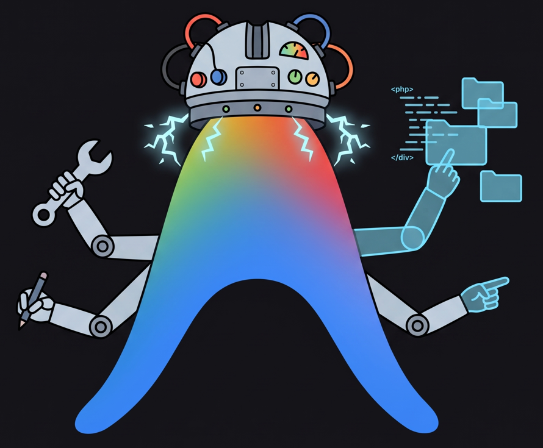
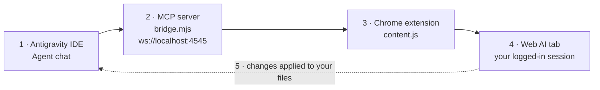

<div align="center">



# Antigravity Universal AI Bridge

**Use the Web AI model you already pay for, directly inside Antigravity IDE.**

[](LICENSE)
[](https://github.com/Eyad-Eladawy/antigravity-universal-ai-bridge/actions/workflows/ci.yml)
[](https://github.com/Eyad-Eladawy/antigravity-universal-ai-bridge/releases/latest)
[](CONTRIBUTING.md)

Gemini · Claude · ChatGPT · DeepSeek

[Download](https://github.com/Eyad-Eladawy/antigravity-universal-ai-bridge/releases/latest) · [Setup guide (PDF)](docs/Setup-Guide.pdf) · [Report a bug](https://github.com/Eyad-Eladawy/antigravity-universal-ai-bridge/issues/new/choose) · [Contribute](CONTRIBUTING.md)

</div>

---

## What is it?

The bridge connects **Antigravity IDE** to your already-open, logged-in **Web AI** tab (Gemini, Claude, ChatGPT or DeepSeek).

The IDE's local model is forced to act only as a **context gatherer and file executor**. All the heavy thinking (coding, debugging, architecture) is delegated to the Web AI model you prefer, and the answer is applied to your workspace files automatically. No copy-paste between browser and editor.

> Same tools. Same subscription. A much stronger brain.

## How it works



## Features

| | |
|---|---|
| **Universal support** | Gemini, Claude, ChatGPT and DeepSeek. Switch the active "Architect" with one click. |
| **Delta tracking** | Full context is sent once per chat. Follow-ups only send what changed (saves tokens). |
| **Context discovery** | Finds files like `STATE.md`, `ARCHITECTURE.md`, `ROADMAP.md`, `REQUIREMENTS.md`, `.cursorrules`. |
| **Human-in-the-loop** | Runs inside your real browser session over a local WebSocket. No API keys, no scraping accounts. |
| **Auto rule injection** | Adds the required system rule to `~/.gemini/GEMINI.md` so the IDE model acts as executor, not author. |

## Requirements

- [Node.js](https://nodejs.org) 18+
- Google Chrome (or any Chromium-based browser)
- Antigravity IDE

## Install (3 steps)

**1. Get the package.** Download `gemini-bridge.zip` from the [latest release](https://github.com/Eyad-Eladawy/antigravity-universal-ai-bridge/releases/latest) and extract it to a **permanent** folder, e.g. `D:/gemini-bridge`. The release already includes `node_modules`, so no terminal is needed.

<details>
<summary>Prefer building from source?</summary>

```bash
git clone https://github.com/Eyad-Eladawy/antigravity-universal-ai-bridge.git
cd antigravity-universal-ai-bridge
npm install
```
</details>

**2. Load the Chrome extension.**
1. Open `chrome://extensions`
2. Enable **Developer mode** (top-right)
3. Click **Load unpacked** and select the `extension` folder
4. Make sure the extension is enabled

**3. Link the MCP server in Antigravity.** Open **Manage MCPs → View raw config** (`mcp_config.json`) and add (update the path to where you extracted it):

```json
{
  "mcpServers": {
    "gemini-web-pro": {
      "command": "node",
      "args": ["D:/gemini-bridge/extension/bridge.mjs"]
    }
  }
}
```

Save, then click **Refresh** in *Manage MCP servers*.

## Daily use

1. Open a supported site in Chrome: `gemini.google.com`, `claude.ai`, `chatgpt.com` or `chat.deepseek.com`.
2. Click the floating status button at the top of the page once, until it turns **green**.
3. Type your task in the Antigravity **Agent chat** and press **Proceed**.

| Button | Meaning |
|---|---|
| ⚪ White | Standby. Click to dedicate this tab to Antigravity. |
| 🟢 Green | Connected. This tab is the active Architect. |
| 🔵 Blue | Processing an Antigravity task. |
| 🟡 Yellow | Connecting. The IDE hasn't started the MCP server yet. |

Need a fresh full-context bundle? Just open a **New Chat** in the browser tab.

## Troubleshooting

- **`EADDRINUSE: address already in use :::4545`**: another bridge instance is running. End the Node.js processes in Task Manager, then click **Refresh** in Manage MCPs.
- **Button stays yellow**: check that the path in `mcp_config.json` points to the exact location of `bridge.mjs`, then click **Refresh**.

Full walkthrough with screenshots: [docs/Setup-Guide.pdf](docs/Setup-Guide.pdf).

## Privacy & security

- Everything runs **locally**. The extension talks to `ws://localhost:4545`; nothing is sent to a Trignod server.
- On start, `bridge.mjs` **writes a rule block to `~/.gemini/GEMINI.md`** (only if it's not already there). Review [`extension/bridge.mjs`](extension/bridge.mjs) if you want to see exactly what it adds.
- The extension only runs on the four AI sites listed in [`manifest.json`](extension/manifest.json).
- Found a vulnerability? See [SECURITY.md](SECURITY.md).

## Contributing

Contributions are welcome. **All changes go through a pull request and need the maintainer's approval before merging.** Please read [CONTRIBUTING.md](CONTRIBUTING.md) first.

## License

[GPL-3.0](LICENSE) © 2026 Eyad / [Trignod.ai](https://trignod.ai)

You are free to use, study, modify and share this project. If you distribute a modified version, it must stay open source under the same GPL-3.0 license.

<div align="center"><sub>Powered by <b>Trignod.ai</b></sub></div>
